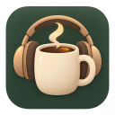

# Pofi v1.3.0 — Góc tập trung lofi



Pofi là ứng dụng Pomodoro kết hợp với nhạc nền từ YouTube, giúp bạn tập trung làm việc hiệu quả. Ứng dụng được phát triển bằng Electron và Vue.js, hỗ trợ cả Windows và macOS.

## Tính năng chính

### 🕒 Pomodoro Timer
- Thiết lập riêng thời gian tập trung, nghỉ ngắn và nghỉ dài
- Chọn số vòng tập trung trước mỗi lần nghỉ dài (1–100 vòng)
- Bật/tắt riêng tự bắt đầu nghỉ và tự bắt đầu phiên tập trung
- Hiển thị vòng hiện tại, tổng phiên hoàn thành; tạm dừng/tiếp tục cả khi nghỉ
- Thông báo khi kết thúc phiên làm việc/nghỉ ngơi
- Chuyển sang phiên tiếp theo và chờ bấm bắt đầu, hoặc chạy tự động theo lựa chọn

### 🎵 Nhạc nền
- Phát nhạc từ YouTube
- Tìm kiếm bài hát yêu thích
- Điều chỉnh âm lượng
- Nhiều âm thanh môi trường (mưa, sông suối, thành phố, tiếng ồn trắng, lửa, sóng biển)

### ❤️ Danh sách yêu thích
- Lưu các bài hát yêu thích
- Phát lại nhanh chóng
- Quản lý danh sách dễ dàng

### 📜 Lịch sử phát
- Lưu 50 bài hát gần nhất
- Không lưu trùng lặp
- Phát lại nhanh chóng

### ✅ Quản lý công việc
- Thêm, xóa, đánh dấu hoàn thành công việc
- Thiết lập mức độ ưu tiên (thấp, trung bình, cao)
- Lọc theo trạng thái (tất cả, đang làm, hoàn thành)
- Lưu trữ dữ liệu cục bộ

## Giao diện lofi

Nút chọn giao diện ở thanh trên cùng có ba theme: **Góc ấm**, **Đêm mơ** và **Vườn sớm**. Lựa chọn được lưu tự động, áp dụng cho toàn bộ giao diện và vẫn giữ nguyên sau khi mở lại ứng dụng. Dùng phím mũi tên, Home hoặc End để chuyển lựa chọn khi đang chọn theme.

**Liquid Glass** là công tắc riêng ở đầu bảng Giao diện & nền, áp dụng hiệu ứng kính trong, viền phản sáng và nút bo tròn cho mọi theme. Bật/tắt hiệu ứng không đổi nền hay bảng màu; trạng thái được lưu tự động. Theme Liquid Glass cũ tự chuyển thành nền Đêm mơ cùng hiệu ứng kính bật.

Nguồn nền có thể chọn riêng: **Ảnh lofi** tĩnh, **YouTube mờ** từ ảnh bài nhạc đang phát hoặc **Video** YouTube. Có thể chuyển nhanh bằng nút đổi nền ở thanh nhạc.

Ứng dụng mở trong cửa sổ 460×620, thu nhỏ được đến 320×340 và có nút ghim luôn ở trên. Bố cục tự co theo cả chiều rộng và chiều cao; toàn app không cuộn dọc hoặc ngang. Chỉ nội dung trong bảng và danh sách dài được cuộn.

Thanh tiêu đề hệ thống được thay bằng điều khiển ngay trong app: thu nhỏ, phóng to/khôi phục và đóng. Kéo vùng trống ở thanh trên cùng để di chuyển cửa sổ. Khi cửa sổ hẹp hơn 520px, nhóm tiện ích thu vào nút menu ở bên phải, bấm để trượt ngang ra/vào. Chọn một mục, bấm ra ngoài hoặc nhấn Escape sẽ thu menu; các nút cửa sổ luôn hiện.

Logo lofi mới dùng hình cốc cà phê và tai nghe, đồng bộ trong app, favicon và bộ icon Windows/macOS. Ảnh gốc và prompt được lưu trong [tài liệu logo](design/logo-prompt.md).

Nút **Thu gọn thành dock** ở cạnh các nút cửa sổ chuyển app thành thanh ngang 320×72. Thứ tự điều khiển: đồng hồ → bắt đầu/tạm dừng timer → Skip → play/pause nhạc → mở rộng. Dock tự ghim lên trên, kéo được bằng vùng trống và giữ nguyên timer/player khi đổi chế độ.

Cửa sổ thường và dock nhớ **hai vị trí riêng**: kéo dock không làm đổi vị trí cửa sổ thường, và chuyển lại dock trở về đúng vị trí dock trước đó. Vị trí, kích thước cửa sổ thường và trạng thái phóng to được lưu khi mở lại app; nếu màn hình cũ không còn kết nối, vị trí tự nằm lại trong màn hình hiện có. Mở rộng khôi phục trạng thái ghim trước khi thu vào dock.

Trong **Settings → Thanh dock**, kéo thanh **Kích thước** từ 80–160% (256×58 đến 512×115). Có thể kéo tay nắm ở mép phải dock để đổi trực tiếp; khi tay nắm có focus, dùng mũi tên để đổi 5%, Home/End để chọn nhỏ nhất/lớn nhất. Kích thước được lưu tự động; nội dung co theo cùng tỷ lệ.

Quy chuẩn màu sắc, component và prompt tạo ảnh được ghi trong [bộ giao diện](docs/design-system.md).

## Cài đặt

### Yêu cầu hệ thống
- Windows 10/11 hoặc macOS 10.13+
- 4GB RAM trở lên
- Khoảng 270MB sau khi cài đặt, chưa tính file bộ cài

### Link tải ứng dụng

- Bộ cài Windows x64 v1.3.0 sau khi build: `dist_electron/Pofi Setup 1.3.0.exe`. Mở file này để cài đặt; không cần Node.js.
- Bản chạy trực tiếp để kiểm tra: `dist_electron/win-unpacked/Pofi.exe`; giữ nguyên toàn bộ thư mục đi kèm.
- [Bản Windows cũ v1.2.1](https://drive.google.com/file/d/1OGaqyZdTP6PjFSijZmEHJU88mUyyNU3a/view?usp=sharing).

## Hướng dẫn sử dụng

### Pomodoro Timer
1. Mở **Settings → Nhịp Pomodoro** để chỉnh **Tập trung**, **Nghỉ ngắn**, **Nghỉ dài** và **Nghỉ dài sau** bao nhiêu vòng.
2. Mặc định tập trung 45 phút, nghỉ ngắn 5 phút, nghỉ dài 15 phút sau mỗi 4 vòng. Thời lượng tập trung/nghỉ cũ được giữ lại khi nâng cấp; nghỉ cũ trở thành nghỉ ngắn.
3. Bật riêng **Tự bắt đầu nghỉ** và **Tự bắt đầu tập trung** nếu muốn. Cả hai mặc định tắt; khi chuyển phiên, đồng hồ chờ bạn bấm bắt đầu.
4. Nhấn **Bắt đầu tập trung**. Mỗi phiên tập trung hoàn thành được tính một vòng; sau số vòng đã chọn, nghỉ dài thay cho nghỉ ngắn, rồi chu kỳ tiếp tục.
5. Có thể tạm dừng/tiếp tục cả phiên làm việc và nghỉ. **Skip** từ tập trung sang nghỉ vẫn **cộng 1 vòng**, tính vào mốc nghỉ dài; Skip từ nghỉ sang tập trung không cộng thêm vòng. Nút này có cả trong dock và giao diện thường; chuyển thủ công không phát thông báo hết ca, còn việc tự chạy phiên mới theo hai công tắc bên trên.

Cài đặt được lưu tự động sau khi đóng/mở app. Thay đổi thời lượng không đặt lại phiên đang chạy hoặc tạm dừng; áp dụng từ phiên tiếp theo (hoặc ngay cho phiên đang chờ bắt đầu). Khi máy ngủ rồi bật lại, timer bám thời gian thực và chỉ gửi thông báo hoàn thành gần nhất cho từng loại phiên.

### Nhắc đổi ca toàn màn hình

Bật **Settings → Nhắc đổi ca → Thông báo toàn màn hình** trong ứng dụng máy tính. Mỗi khi hết phiên tập trung hoặc nghỉ, bảng nhắc phủ toàn màn hình nơi con trỏ đang ở và ghim ở mức cao nhất của cửa sổ ứng dụng. Bảng nhắc đếm ngược **10 giây từ khi hiển thị** rồi mới bật nút **Đóng thông báo**; Escape hoặc Alt+F4 cũng chỉ đóng bảng sau thời gian này. Bảng không tự tắt.

Bảng nhắc theo màu theme và lựa chọn kính hiện tại. Nó dùng cửa sổ riêng nên không thay đổi vị trí, kích thước, trạng thái ghim hoặc chế độ dock của app, và không tải lại nhạc. Timer tiếp tục hoặc chờ bắt đầu theo các tùy chọn tự chạy. Tùy chọn toàn màn hình mặc định tắt; khi tắt, app dùng thông báo thông thường. Sau khi máy ngủ qua nhiều phiên, chỉ bảng nhắc của lần đổi ca gần nhất xuất hiện.

### Nhạc nền
1. Mở nút tìm nhạc ở thanh phát, nhập từ khóa hoặc dán link YouTube
2. Nhấp vào bài hát để phát
3. Điều chỉnh âm lượng bằng thanh trượt
4. Thêm vào danh sách yêu thích bằng nút trái tim

Bảng tìm nhạc có nền rõ để dễ đọc cả khi bật hiệu ứng kính. Ô tìm kiếm giữ cố định; danh sách kết quả cuộn riêng và có nút **Tải thêm kết quả** ở cuối. App tải đầy đủ kết quả của từng trang YouTube, loại bài trùng giữa các trang và giữ các bài đã tải khi thử lại sau lỗi mạng.

Tìm kiếm cần kết nối Internet và đọc kết quả công khai từ YouTube qua tiến trình Electron (hoặc endpoint cục bộ khi chạy trình duyệt). Nếu YouTube chặn truy cập hay thay đổi định dạng kết quả, app hiển thị lỗi; bạn vẫn có thể dán link video để phát.

Trình phát tải SDK qua HTTPS. Nếu lần tải đầu bị lỗi mạng hoặc quá thời gian, **Thử lại** tạo yêu cầu mới, không giữ trạng thái lỗi cho các bài sau. App phân biệt lỗi kết nối, video bị xóa/riêng tư và video không cho nhúng; khi trình duyệt chặn tự phát, nút play vẫn dùng được để bắt đầu thủ công.

### Quản lý công việc
1. Nhấp vào biểu tượng danh sách công việc ở góc trên bên phải
2. Nhập tên công việc và chọn mức độ ưu tiên
3. Nhấn Enter hoặc nút "+" để thêm công việc
4. Đánh dấu hoàn thành bằng cách nhấp vào ô checkbox
5. Lọc công việc bằng các nút "Tất cả", "Đang làm", "Hoàn thành"
6. Xóa công việc đã hoàn thành bằng nút "Xóa đã hoàn thành"

## Lịch sử phiên bản

### Chưa phát hành

- Sửa tải player qua HTTP và lỗi lần tải đầu làm các lần thử sau bị kẹt; tải SDK bằng HTTPS, hỗ trợ thử lại và báo lỗi phát cụ thể.
- Tách nghỉ ngắn/nghỉ dài, chọn số vòng trước nghỉ dài và tự bắt đầu riêng cho nghỉ/tập trung.
- Đếm phiên tập trung hoàn thành; tạm dừng hoặc bỏ qua nghỉ mà vẫn giữ tiến độ vòng.
- Skip hai chiều trên giao diện thường/dock; bỏ qua phiên tập trung vẫn cộng vòng.
- Nhắc đổi ca toàn màn hình, ghim trên cùng và chỉ cho đóng sau 10 giây.
- Dock nhớ vị trí riêng, thêm điều khiển timer và thay đổi kích thước 80–160% bằng Settings hoặc kéo trực tiếp.
- Lưu cài đặt mới, giữ thời lượng cũ và bố cục Settings gọn ở cửa sổ 320×340.
- Những thay đổi này nằm trong mã nguồn; bộ cài v1.3.0 đã tạo trước đó chưa bao gồm.

### v1.3.0 — 24/10/2026

- Bộ giao diện lofi gồm Góc ấm, Đêm mơ, Vườn sớm; công tắc Liquid Glass độc lập với nền.
- Logo cốc cà phê và tai nghe mới cho giao diện, favicon và icon ứng dụng.
- Cửa sổ không viền, điều khiển cửa sổ trong app và menu trượt ngang thu gọn khi cửa sổ nhỏ.
- Dock 320×72 tự ghim, giữ timer và nhạc đang phát; mở rộng khôi phục kích thước và trạng thái ghim cũ.
- Nền ảnh tĩnh, ảnh YouTube mờ hoặc video; bố cục responsive không cuộn toàn app.
- Bảng tìm nhạc riêng dễ đọc, tải thêm kết quả theo trang, bỏ trùng và cho thử lại khi lỗi mạng.
- Sửa timer khi chạy nền/ngủ máy, lưu trữ desktop, vòng đời player và lỗi cửa sổ dev không hiển thị.

### v1.2.2
- Ẩn devtool
### v1.2.1
- Cải thiện giao diện người dùng
- Cho phép người dùng xóa lịch sử bài hát 
- Thêm chức năng xem video 
- Random bài hát mới sau khi hết bài

### v1.1.0
- ✨ Thêm tính năng Quản lý công việc
- 🔊 Bổ sung thêm nhiều âm thanh môi trường
- 🌙 Cải thiện giao diện người dùng
- 🐛 Sửa các lỗi nhỏ và cải thiện hiệu suất

## Phát triển

Dùng Node.js 24 và npm. `package-lock.json` là lockfile dùng trong CI. Lockfile Yarn cũ được giữ nguyên trong `yarn.lock.legacy` để tránh Vue CLI yêu cầu cài thêm Yarn.

```sh
npm ci
npm run dev
```

`dev` khởi động Vue tại http://127.0.0.1:8080, chờ giao diện sẵn sàng rồi mở Electron với hot reload. Đóng Electron hoặc nhấn Ctrl+C sẽ dừng các tiến trình của phiên dev. Nếu cổng bận, đặt biến `POFI_DEV_PORT` sang cổng khác.

Các lệnh khác:

| Lệnh | Công dụng |
|---|---|
| `npm start` | Build giao diện rồi chạy ứng dụng desktop |
| `npm run serve` | Chạy giao diện trong trình duyệt |
| `npm run electron:dev` | Kết nối Electron vào Vue dev server đang chạy |
| `npm run build` | Build giao diện vào `dist/` |
| `npm run lint` | Kiểm tra mã nguồn, không tự sửa file |
| `npm test` | Kiểm thử timer, lưu trữ, launcher, tìm kiếm và vòng đời player |
| `npm run test:electron` | Kiểm tra preload, IPC, ba theme, công tắc kính, timer và bố cục trên Electron thật; dùng `dist/` có sẵn hoặc đặt `POFI_DEV_URL` tới dev server |
| `npm run build:electron` | Build và tạo bộ cài cho hệ điều hành hiện tại |
| `npm run build:win` | Build bộ cài Windows NSIS x64, không tự phát hành |
| `npm run package-win` | Tạo thư mục ứng dụng Windows bằng Electron Packager |
| `npm run package` | Tạo thư mục ứng dụng macOS x64 bằng Electron Packager |

Bản cài Windows nằm trong `dist_electron/`; bản Packager nằm trong `package/`. Icon đã có sẵn trong repository; dùng `npm run generate-icons` khi thay logo. CI kiểm tra lint/test rồi đóng gói Windows và macOS, chỉ tạo GitHub Release khi đẩy tag `v*`. Các bản build chưa cấu hình chứng chỉ ký mã.

### Kiến trúc

- `electron/timer.js`: một bộ đếm dựa trên mốc kết thúc; Electron tự chuyển phiên và gửi thông báo dù renderer chạy nền. Sau phiên nghỉ ứng dụng trở về trạng thái chờ.
- `electron/storage.js`: lưu file JSON bằng cách ghi file tạm rồi thay thế; giữ bản sao khi file JSON hỏng.
- `shared/validation.js`: kiểm tra thời lượng và chuẩn hóa dữ liệu được dùng chung ở main process và giao diện.
- `src/services/youtube-player.js`: quản lý một player, một vòng cập nhật tiến độ; loại bỏ callback từ bài cũ.
- `src/components/MusicPlayer.vue`, `MusicSearch.vue`: phát nhạc và tìm kiếm.
- `src/App.vue`: quản lý các bảng chức năng qua props/emits.
- Âm thanh môi trường chỉ khởi tạo player khi tăng âm lượng; tắt tiếng sẽ tạm dừng player.

### Dữ liệu và giới hạn

Desktop lưu cài đặt, công việc, lịch sử và yêu thích trong `settings.json` thuộc thư mục `app.getPath('userData')`, độc lập với cổng HTTP. Ứng dụng nhập dữ liệu từ localStorage của origin đang mở cho các mục chưa được nhập hoặc chỉnh sửa trên desktop. Mặc định được tạo khi chạy ở cổng mới không chặn việc nhập dữ liệu cũ sau này; các mục đã chỉnh sửa trên desktop được ưu tiên. Nếu trước đây từng chạy trên cổng khác, cần mở lại origin cũ để lấy dữ liệu trước khi di chuyển thủ công.

Trình duyệt dùng localStorage theo origin. Timer trình duyệt cũng dùng mốc kết thúc nhưng thông báo phụ thuộc vào quyền đã cấp và việc trang còn mở. Desktop vẫn giữ timer khi reload giao diện; đóng hoàn toàn ứng dụng sẽ dừng phiên hiện tại.

Thời lượng làm việc/nghỉ phải là số nguyên từ 1 đến 1440 phút. Nhạc và tìm kiếm cần kết nối YouTube. Bản này đọc kết quả tìm kiếm công khai; nếu YouTube giới hạn truy cập, bạn có thể thử lại hoặc dán URL/video ID để phát. Âm báo desktop nằm ngoài ASAR trong `resources/sounds/`.

## Giấy phép

Phát triển bởi Hải Dev - © 2025
